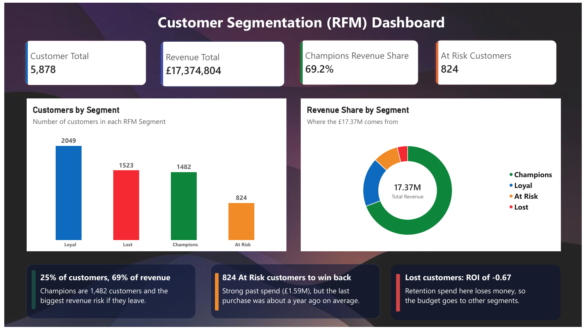
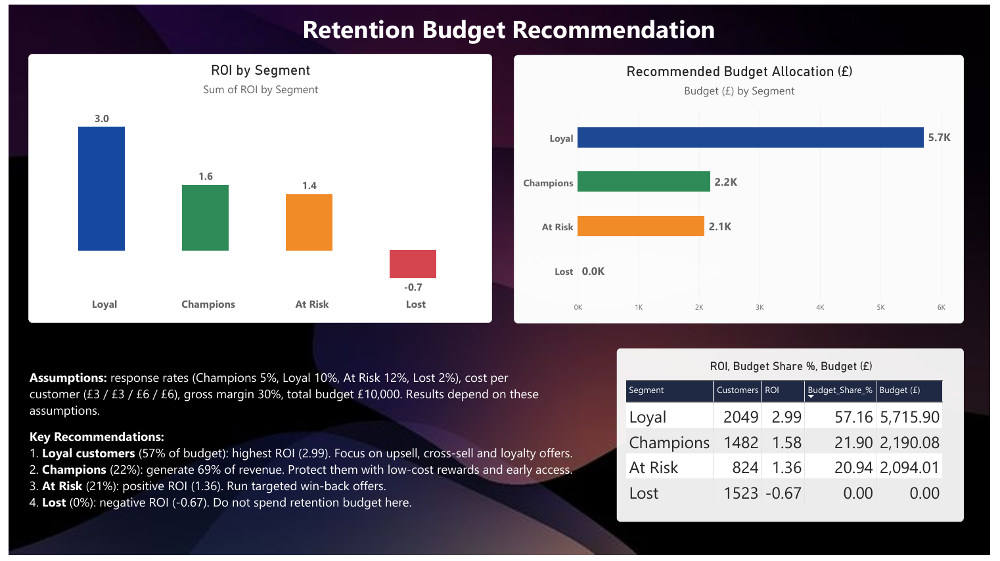

# Customer Segmentation and RFM Analysis (Retail / E-commerce)

A customer segmentation project that groups an online retailer's customers using RFM analysis, estimates the return on retention campaigns for each segment, and recommends how a marketing team should split its retention budget. Built with Python (pandas) and a 2-page Power BI dashboard.




## Business question

Which customer segments will give the highest ROI on retention campaigns, and how should the marketing team allocate the budget?

## Dataset

- **Online Retail II** (UK-based online retailer), available on Kaggle and the UCI Machine Learning Repository
- 1,067,371 transaction rows, 1 Dec 2009 to 9 Dec 2011
- Columns: Invoice, StockCode, Description, Quantity, InvoiceDate, Price, Customer ID, Country
- The raw file is not included in this repository because of its size. Download it from Kaggle and place it in the `data/` folder.

## Tools

- Python: pandas, NumPy (Google Colab)
- Power BI Desktop (dashboard)

## Approach

### 1. Data cleaning

| Step | Rows left |
|---|---|
| Raw data | 1,067,371 |
| Removed rows with missing Customer ID | 824,364 |
| Removed rows with zero or negative Quantity (returns and cancellations) | 805,620 |
| Removed rows with zero or negative price | 805,549 |
| Removed duplicate rows | 779,425 |

Final data: 779,425 rows, **5,878 customers**, total revenue **£17,374,804**.

### 2. RFM table

For every customer:

- **Recency**: days between the customer's last purchase and the day after the last date in the data
- **Frequency**: number of unique invoices
- **Monetary**: total spend (Quantity x Price)

### 3. RFM scoring

Each of R, F and M was split into five equal groups (quintiles) with `pd.qcut` and scored 1 to 5. Recency is scored in reverse, because fewer days since the last purchase is better. Frequency has many ties (many customers bought only once), so ranks were used before splitting.

### 4. Segments

| Segment | Rule |
|---|---|
| Champions | R score 4 or 5 and F score 4 or 5 |
| At Risk | R score 1 or 2 and F score 3 or higher |
| Lost | R score 1 or 2 and F score 1 or 2 |
| Loyal | All other customers |

### 5. ROI and budget model

The dataset has no campaign cost or response data, so the ROI model uses **assumptions**:

| Segment | Assumed extra response rate | Assumed cost per customer |
|---|---|---|
| Champions | 5% | £3 |
| Loyal | 10% | £3 |
| At Risk | 12% | £6 |
| Lost | 2% | £6 |

- Average order value per segment = average spend / average number of orders
- Gross margin: 30%
- Total retention budget: £10,000
- ROI = (expected profit - campaign cost) / campaign cost
- Budget is split in proportion to each segment's net gain. Segments with negative net gain get no budget.

## Key results

| Segment | Customers | Share of customers | Revenue | Share of revenue | ROI | Recommended budget |
|---|---|---|---|---|---|---|
| Champions | 1,482 | 25.2% | £12.02M | 69.2% | 1.58 | £2,190 (21.9%) |
| Loyal | 2,049 | 34.9% | £3.11M | 17.9% | 2.99 | £5,716 (57.2%) |
| At Risk | 824 | 14.0% | £1.59M | 9.1% | 1.36 | £2,094 (20.9%) |
| Lost | 1,523 | 25.9% | £0.65M | 3.8% | -0.67 | £0 |

## Recommendations

1. **Loyal customers (57% of budget):** highest ROI. Focus on upsell, cross-sell and loyalty offers.
2. **Champions (22%):** they bring about 69% of revenue from 25% of customers. Protect them with low-cost rewards and early access.
3. **At Risk (21%):** positive ROI. Run targeted win-back offers. These customers spent well in the past but have not bought for about a year on average.
4. **Lost (0%):** negative ROI. Do not spend retention budget here.

## Limitations

- ROI results depend on the assumed response rates, costs and margin. I tested the logic, but real campaign data would be needed to confirm the numbers.
- Rows without a Customer ID (about 23% of the raw data) were excluded, because RFM needs a customer identity.
- The segment rules are simple and rule-based. The "Loyal" segment also includes newer customers who have not yet bought often.
- The data comes from one UK online retailer and covers 2009 to 2011, so results may not apply directly to other businesses.

## Repository structure

```
.
├── data/                 # place the Online Retail II CSV here (not included)
├── notebooks/            # Google Colab notebook (cleaning, RFM, segments, ROI)
├── dashboard/            # Power BI file (.pbix), PDF export and screenshots
└── README.md
```

## Author

Gaurav Yadav
LinkedIn: add your LinkedIn link here
Email: add your email here
